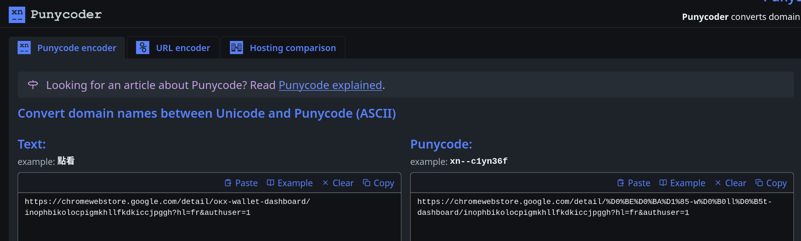
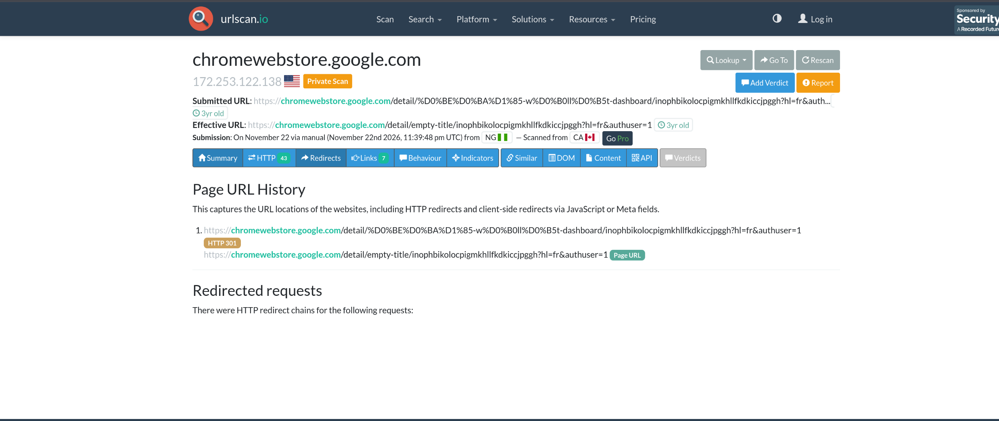

# Phishing Analysis: OKX Web3 Wallet Extension Impersonation

**Date analyzed:** 2026-11-24
**Analyst:** Akinola Selim Ishola
**Severity:** High
**Status:** Confirmed malicious

## Summary

A phishing email impersonating the cryptocurrency exchange OKX was relayed through a compromised Chinese corporate mail server (handpay.com.cn) using attacker infrastructure hosted on a Russian VPS provider. The email pushed recipients to install a fake "OKX Web3 Extension" from a genuinely-hosted Google Chrome Web Store listing, whose name was spoofed using Cyrillic homoglyph characters to impersonate the real OKX Wallet. The listing has since been taken down by Google.

## Email Headers

```
Date: Wed, 8 Jul 2026 15:16:17 +0800 (origin) / 07:16:35 +0000 (delivered)
Subject: rodrigo-f-p ⭐ 4.7/5 Rating: OKX Web3 Extension on Chrome Web Store
From: =?UTF-8?B?T0tYIEV4dGVuc2lvbg==?= <hpayMonitorPlatform@handpay.com.cn>
To: phishing@pot
Envelope-From: hpayMonitorPlatform@handpay.com.cn
```

The From display name is base64-encoded. Decoded:

```
echo T0tYIEV4dGVuc2lvbg== | base64 -d
OKX Extension
```

This confirms the sender is impersonating OKX in the display name while using a completely unrelated address on a compromised domain.

## Sender Infrastructure (Received Chain, Bottom to Top)

| Hop | From | To | Notes |
|---|---|---|---|
| 1 (origin) | sb8b3bcb5.fastvps-server.com (5.188.28.177) | HPEX15.handpay.com.cn | True origin, Russian VPS hosting provider |
| 2 | HPEX15.handpay.com.cn (10.148.192.86, internal) | spam1.handpay.com.cn | verify=FAIL on TLS; internal hop named "spam1" |
| 3 | spam1.handpay.com.cn (180.168.61.82) | BL6PEPF00020E61.mail.protection.outlook.com | Entry point into Microsoft 365 (PEPF front door) |
| 4–6 | — | — | Internal Microsoft 365 routing (trusted, not evidentiary) |

### WHOIS: 5.188.28.177 (true origin)

```
inetnum:        5.188.28.0 - 5.188.28.255
netname:        VPS-NET
descr:          Network for hosting services
country:        RU
origin:         AS200487
abuse contact:  https://my.fastvps.ru/abuse
```

Confirms the origin IP belongs to FastVPS, a Russian commercial hosting provider, not any legitimate OKX or handpay.com.cn infrastructure, a typical pattern for disposable attacker infrastructure.

## Authentication Header and Analysis

```
Authentication-Results: mx.corhalitech.example;
    spf=none (sender IP is 180.168.61.82) smtp.mailfrom=handpay.com.cn;
    dkim=fail (no key for signature) header.d=http://dev.roombird.ru/;
    dmarc=none action=none header.from=handpay.com.cn;
    compauth=pass reason=105
```

- **SPF:** None. handpay.com.cn has no SPF record published.
- **DKIM:** Fail. The `header.d=` value is malformed, it's a full URL (`http://dev.roombird.ru/`) rather than a plain domain, which is invalid per the DKIM spec. This points to an unrelated domain (dev.roombird.ru) with no legitimate connection to handpay.com.cn, likely a signature injected by the attacker's mailer software.
- **DMARC:** None published.
- **compauth=pass reason=105:** Microsoft's composite authentication passed only because there is no DMARC policy to enforce (an implicit pass, not a genuine authentication success). This should not be read as a positive signal.

**Verdict:** No real authentication in place. SPF absent, DKIM broken/malformed, DMARC absent. The sending domain (handpay.com.cn) appears to be a legitimate business domain that has been compromised and is being abused to relay phishing mail through attacker-controlled VPS infrastructure.

## Content Analysis

The email body (also base64-encoded, decoded below) is a mass-marketing-style promotion for a fake "OKX Web3 Extension":

- Hype/urgency language: "10 million users worldwide", "4.7/5 Rating", "Compliant with Chrome Web Store Policies"
- No personalization (generic "Web3 Enthusiasts and Blockchain Lovers" greeting)
- Call to action: install a Chrome extension via a Chrome Web Store link
- A Chinese-language confidentiality disclaimer appears at the bottom of the email, inconsistent with a message supposedly from OKX (a global exchange), another sign the true sender is unrelated to the impersonated brand

## URL / Payload Analysis

Malicious link found in the body:

```
hxxps://chromewebstore[.]google[.]com/detail/окх-wаllеt-dashboard/inophbikolocpigmkhllfkdkiccjpggh?hl=fr&authuser=1
```

### Homoglyph Analysis

The hostname (`chromewebstore.google.com`) is genuine, unmodified Google infrastructure, confirmed via IDNA encoding (no conversion occurs, since the hostname is pure ASCII). The spoofing is entirely in the **URL path / listing slug**, not the domain.

Decoding the percent-encoded path (`%D0%BE%D0%BA%D1%85-w%D0%B0ll%D0%B5t-dashboard`) and inspecting each character:

| Char | Unicode | Real identity | Impersonating |
|---|---|---|---|
| о | U+043E | CYRILLIC SMALL LETTER O | Latin o |
| к | U+043A | CYRILLIC SMALL LETTER KA | Latin k |
| х | U+0445 | CYRILLIC SMALL LETTER HA | Latin x |
| а | U+0430 | CYRILLIC SMALL LETTER A | Latin a |
| е | U+0435 | CYRILLIC SMALL LETTER IE | Latin e |



### urlscan.io Verification



The scan shows the submitted URL (with the homoglyph slug) returns an HTTP 301 redirect to:

```
hxxps://chromewebstore[.]google[.]com/detail/empty-title/inophbikolocpigmkhllfkdkiccjpggh?hl=fr&authuser=1
```

`empty-title` is Google's placeholder for a listing that has been removed. **As of this analysis (24 Nov 2026), the malicious extension listing has been taken down by Google.** The extension ID remains a valid IOC for retrospective detection and blocking even though the live listing is gone.

## Indicators of Compromise (IOC)

| Type | Value | Notes |
|---|---|---|
| IP (true origin) | 5.188.28.177 | FastVPS, AS200487, Russia |
| IP (compromised relay) | 180.168.61.82 | spam1.handpay.com.cn |
| Domain (compromised sender) | handpay.com.cn | No SPF/DKIM/DMARC |
| Domain (malformed DKIM reference) | dev.roombird.ru | Unrelated domain in forged DKIM tag |
| Email address | hpayMonitorPlatform@handpay.com.cn | Envelope-from |
| Display name (decoded) | OKX Extension | Base64-encoded brand impersonation |
| Malicious URL | hxxps://chromewebstore[.]google[.]com/detail/окх-wаllеt-dashboard/inophbikolocpigmkhllfkdkiccjpggh | Homoglyph-spoofed slug |
| Chrome extension ID | inophbikolocpigmkhllfkdkiccjpggh | Taken down as of 24 Nov 2026 |
| Hosting provider abuse contact | https://my.fastvps.ru/abuse | For reporting origin IP |

## Verdict

Malicious. A phishing/malicious browser-extension distribution campaign impersonating OKX, delivered through a compromised corporate mail server and attacker-rented VPS infrastructure. The email has no valid SPF, a malformed/broken DKIM signature, and no DMARC policy. It links to a real Google Chrome Web Store listing whose name was spoofed with Cyrillic homoglyph characters to impersonate "OKX Wallet," almost certainly intended to steal cryptocurrency wallet credentials or funds once installed. Google has since removed the listing.

## Recommended Actions

- Block 5.188.28.177, 5.188.28.0/24, and 180.168.61.82 at the mail gateway/firewall
- Report the origin IP to FastVPS abuse (https://my.fastvps.ru/abuse)
- Search mail logs for other messages from the same IPs or sender
- If the extension (ID: inophbikolocpigmkhllfkdkiccjpggh) was installed by any user prior to takedown, treat their crypto wallet and credentials as compromised and advise moving funds immediately
- User awareness training on brand-impersonation phishing and homoglyph-based link spoofing
