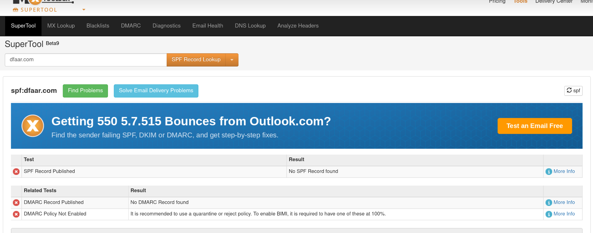

# Phishing Analysis: Google Calendar Reminder

**Date analyzed:** 2026-11-25
**Analyst:** Akinola Selim Ishola
**Severity:** Medium
**Status:** Confirmed malicious

## Summary

A fake McAfee renewal notice was delivered through a genuine Google Calendar invite, sent from a Google Workspace account registered under the domain dfaar.com. Because the sender owns a real, paid Google Workspace subscription, the email passed DKIM authentication, showing that authenticated delivery does not mean legitimate intent. The scam pushes the victim to call a fake support line, a tech-support phone scam rather than a credential-phishing link.

## Email Headers

```
Date: Wed, 01 Apr 2026
Subject: Reminder: Your Service Plan Renewal is Approaching
To: phishing@pot
From: Sharonda Vargas <sharondava260231268@dfaar.com>
Sender: Google Calendar <calendar-notification@google.com> -- This is sent on behalf of the From header: Sharonda Vargas <sharondava260231268@dfaar.com>
Sender IP: 209.85.161.74
Resolve host: mail-oo1-f74.google.com
Reply-To: Sharonda Vargas <sharondava260231268@dfaar.com>
```

## Sender Infrastructure

| IP | Role | Owner/ASN |
|---|---|---|
| 209.85.161.74 | True origin | google mail |

## Authentication Header and Analysis

```
Received-SPF: None (protection.outlook.com: dfaar.com does not designate permitted sender hosts)
```
dfaar.com has no established online business presence and is flagged in public abuse databases for phishing and malware emails.



MXToolbox SuperTool lookup confirms: no SPF record published, no DMARC record published, and DMARC policy not enabled, independently verifying the authentication gaps seen in the raw headers.

**DKIM-Signature 1:** `d=dfaar-com.20230601.gappssmtp.com; s=20230601; ... darn=hotmail.com`
- gappssmtp.com is a default DKIM signing domain used by Google Workspace when a custom DKIM key is not configured for a sending domain.
- Highlights that dfaar.com is a registered domain using Google Workspace without any custom DKIM key set up.

**DKIM-Signature 2:** `d=google.com; s=20251104; ... darn=hotmail.com`
Google's own signed signature.

**DMARC:** No policy published.

**Verdict:** SPF not published, DKIM passes (signed by both google.com and the domain's own Workspace key, domain DKIM not set), DMARC not enforced.

## Content Analysis

- The email is impersonating McAfee, an antivirus company.
- The content of the email compares McAfee to Mcαfee.
- The name of the company does not match the one on their official website, missing the capital "A".
- The letter "a" from the email body is not a plain Latin character, which decodes as a sign of a homograph attack.
- Spoofed a different company, "Norton Life lock tech support".
- The listed product is "Webroot Standard", a third unrelated antivirus brand.
- Three different security vendors (McAfee, Webroot, Norton) appear in one email, strong evidence of a copy-pasted scam template reused across campaigns without the attacker bothering to keep the branding consistent.
- The help-line numbers (1 865 287-0198, 1 810 297-8331) do not match the one on the McAfee website.
- Different company name used in the signature: Norton Life lock tech support.

## Indicators of Compromise (IOC)

| Type | Value |
|---|---|
| Sender address | sharondava260231268@dfaar.com |
| Sender domain | dfaar.com |
| Forged support number | 1 865 287-0198 |
| Forged support number | 1 810 297-8331 |
| Homoglyph brand name | Mc=CE=B1Fee (U+03B1 GREEK SMALL LETTER ALPHA) |
| Fake company name | Norton Life lock tech support |
| Victim tracking token | Client ID: CBJF4OXR0K |

**Verdict:** Malicious. A registered domain with a real Google Workspace subscription, used to send a fully DKIM-authenticated phishing/tech-support scam via a genuine Google Calendar invite. SPF and DMARC are not enforced, but DKIM passes, meaning the attacker didn't need to forge authentication at all.

## Recommended Actions

- Block sender domain/IP at the mail gateway
- User awareness training on phishing emails
- Report the abusive account directly to Google Workspace abuse (since dfaar.com is a real, paid tenant Google can suspend)

## Sample Source

Original email sample sourced from: [https://github.com/rf-peixoto/phishing_pot/blob/main/email/sample-10012.eml]
